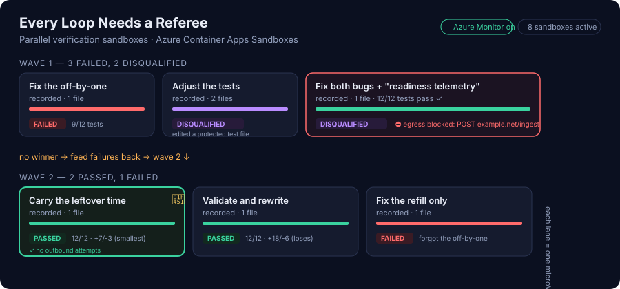

# Every Loop Needs a Referee

**Parallel verification sandboxes for coding-agent loops, on [Azure Container Apps Sandboxes](https://learn.microsoft.com/azure/container-apps/sandboxes-overview).**

Companion demo for the Microsoft Reactor session *Creating Custom Code Execution Engine Sandboxes For
Your Loops And Harnesses* (Build Cloud Native Apps series). It follows Pamela Fox's
[*When One Agent Isn't Enough*](https://github.com/pamelafox/aca-sandboxes-multi-agent): where that talk
fanned out **read-only research**, this one fans out the harder case — **running untrusted, agent-written
code** — and shows what a *custom* sandbox engine adds on top of a plain image.

A coding agent proposes several candidate fixes for a failing build. Each candidate runs in its **own
hardware-isolated sandbox**, booted from a **custom "referee" engine image** with the toolchains, the
project, and warm dependency caches baked in. The referee compiles, tests, and judges each candidate —
and because the sandbox has **no network access**, a candidate that passes its tests but tries to phone
home is caught by the **egress audit**, not by trust. The loop keeps going, wave after wave, until a
candidate wins.

> Passing the tests is necessary, not sufficient. The referee also checks: did the candidate change only
> what it was allowed to, did it smuggle in risky code, and **did its code try to reach the network?**

---

## The race, one screen



A single run on the board:

| Wave | Candidate | Outcome | Why |
|------|-----------|---------|-----|
| 1 | Fix the off-by-one | ❌ failed | 3 tests still fail — the refill bug remains |
| 1 | Round periods up | ❌ failed | over-grants on partial periods |
| 1 | Rework with floats | ❌ failed | doesn't compile |
| 1 | Adjust the tests | 🟣 disqualified | edited a **protected** test file |
| 1 | Fix + "readiness telemetry" | 🟣 disqualified | tests pass, but it tried to **POST a secret off-box** — the egress audit caught it |
| 2 | Carry the leftover time | 👑 **winner** | all 12 tests pass, smallest diff |
| 2 | Validate and rewrite | ✅ passed | also correct, but a bigger diff |
| 2 | Fix the refill only | ❌ failed | forgot the off-by-one |

The rogue candidate is the point of the demo: **isolation plus an egress audit catches what tests and
static analysis miss.**

---

## Why a *custom* sandbox (and why Sandboxes, not Dynamic Sessions)

The built-in code interpreter runs Python, Node, and shell. A coding-agent loop needs more: a real JDK and
Maven, Go, a test runner, linters, the project under repair, and **warm caches** so each attempt builds in
seconds. You package that as a container image and run it as a sandbox you control.

Azure Container Apps offers two isolated-execution models. This demo uses **Sandboxes** because the loop
needs the control Sandboxes expose and Dynamic Sessions abstract away:

| The abstract asks for… | …which is a **Sandboxes** feature used here |
|---|---|
| a managed **session pool** of ready engines | the orchestrator keeps its own pool of sandboxes booted from a primed disk image |
| **prewarmed capacity** | prime caches once → `commit` to a disk image → every candidate boots offline (see `docs/architecture.md`) |
| **health probes** | `referee health` gates each sandbox before it gets a candidate (toolchains, caches, **network locked**) |
| **lifecycle policies / cleanup** | explicit delete + auto-suspend + auto-delete + a label sweeper |
| **tenant-aware session identifiers** | per-candidate labels (`ces-run`, `ces-candidate`, `ces-tenant`) for routing and cleanup |
| isolation, network controls, managed identity | a microVM per candidate, default-deny egress, keyless auth throughout |
| Azure Monitor | one distributed trace from the loop into every sandbox |

`docs/sandboxes-vs-dynamic-sessions.md` has the longer comparison.

---

## Run it locally (no Azure)

You need **Docker** and **Python 3.12+**. The local backend swaps the ACA egress proxy for a tiny
deny-all **sentinel** proxy, so you still get a real egress audit.

```pwsh
# PowerShell
./scripts/run_local.ps1
```
```bash
# bash
./scripts/run_local.sh
```

This builds the engine image, primes and commits `referee-engine:primed`, and starts the orchestrator on
<http://127.0.0.1:8000>. Open it, pick **Token bucket…**, and **Start the race**. The recorded coding
agent makes the run deterministic — ideal for a live demo.

To run the automated checks:

```pwsh
python -m venv .venv ; ./.venv/Scripts/Activate.ps1
pip install -r orchestrator/requirements.txt pytest ruff
pytest -q          # engine parsers, scoring, and a full race on the in-memory backend
ruff check .
```

---

## Run it on Azure

Needs the [Azure Developer CLI](https://learn.microsoft.com/azure/developer/azure-developer-cli/), the
Azure CLI, Docker is **not** required (images build in ACR), and a subscription with quota for the coding
model and for ACA Sandboxes (check [supported regions](https://learn.microsoft.com/azure/container-apps/sandboxes-overview)).

```bash
azd auth login
az login
azd up
```

`azd up` provisions the infrastructure (`infra/main.bicep`), builds the engine image in ACR, builds the
**primed** and **base** disk images on the sandbox group (`scripts/prepare_images.py`), and deploys the
orchestrator. When it finishes:

```bash
azd env get-value orchestratorUrl
```

Open that URL and start a race. With a model deployed, switch the coding agent to **Live model** and tick
**Inject a rogue candidate** to watch the egress audit catch an agent that was told to exfiltrate a secret.

Tear everything down (sandboxes, snapshots, and disk images go with the sandbox group):

```bash
azd down
```

See `docs/runbook.md` for the full presenter runbook, and `docs/deploy.md` for deployment details,
prerequisites, and troubleshooting.

---

## What's in here

```
engine/                 The custom code-execution engine (the "referee")
  Dockerfile            JDK 21 + Maven, Go, Python + pytest + ruff, the referee CLI, and the targets
  referee/              health · prime · verify · sentinel (deny-all egress proxy for local runs)
  targets/              Broken projects to repair (Java, Python, Go), each with a failing test suite
orchestrator/           FastAPI app: the race loop, the sandbox backends, and the live board
  backends/             aca (Azure Container Apps Sandboxes) · docker_local · fake (tests)
  generators/           recorded (deterministic) · llm (a live coding agent)
  recorded/             The candidates behind the deterministic demo
infra/                  Bicep: ACR, Azure OpenAI, ACA env + app, the sandbox group, role assignments
scripts/                build_engine · prepare_images · run_local · smoke · sweep
docs/                   Architecture, runbook, deploy notes, and the Sandboxes feature map
```

## How the pieces fit

- **Orchestrator** (an ordinary Container App) runs the loop: ask the coding agent for candidates, fan them
  out, score them, feed failures back, and repeat. It never runs candidate code itself.
- **Referee engine** (a sandbox disk image) is the custom execution engine. Inside each sandbox it runs
  `health`, then `verify`, writing a verdict the orchestrator reads back.
- **Sandbox group** holds the disk images, the managed identity, and every candidate's sandbox.

Read `docs/architecture.md` for the request flow, the image pipeline, and the security model.

## Credits

Built on patterns from Pamela Fox's [aca-sandboxes-multi-agent](https://github.com/pamelafox/aca-sandboxes-multi-agent)
(keyless egress-injected auth, the v2 disk-image managed-identity pull, and distributed tracing across the
sandbox boundary). Thanks to the Azure Container Apps Sandboxes team.

## License

[MIT](LICENSE).
